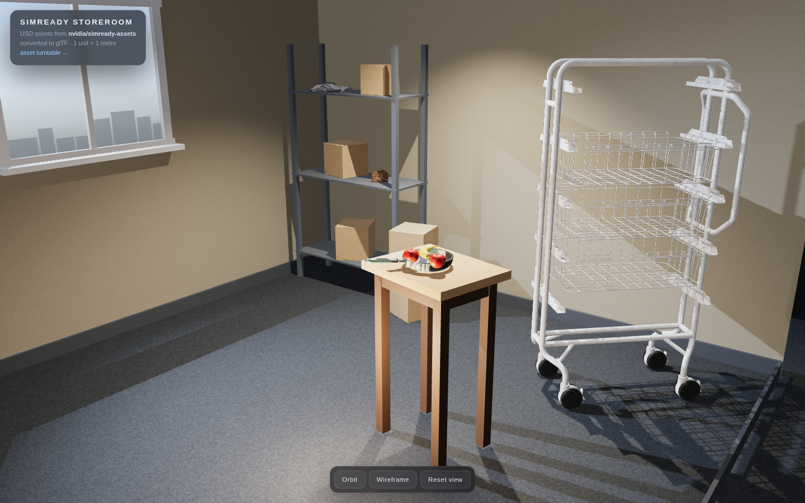
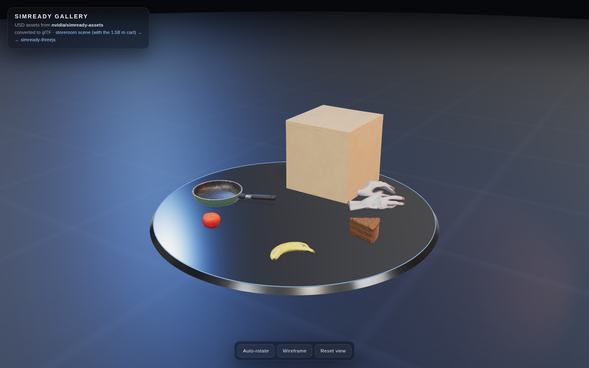

# SimReady Storeroom

A real-time **three.js** room built from [NVIDIA SimReady](https://huggingface.co/datasets/nvidia/simready-assets)
USD assets. Everything you see is real geometry from the dataset — a 1.58 m
mobile cart, a corrugated carton, a frying pan, produce, a cake slice and a pair
of PPE gloves — converted to glTF and placed at true scale (1 unit = 1 metre).

**Live demo:** https://imsarah.github.io/simready-storeroom/





| Storeroom scene | Asset turntable |
| --- | --- |
| `index.html` | `gallery.html` |

## Why this exists

SimReady assets ship as layered USD: a thin entry stage payloads geometry from
`payloads/`, with the actual meshes living inside **native instance prototypes**
and textures referenced relative to the *authoring layer*, not the entry file.
You cannot load a SimReady `.usd` in a browser, and naive converters drop the
instances, the UV index streams or the textures.

`tools/convert_simready.py` handles that: it walks the composed stage
(prototypes included), bakes world transforms, converts Z-up metres to Y-up,
resolves texture paths per layer, rebuilds `primvars:st` from
`primvars:st:indices`, and writes one GLB with albedo / normal / ORM maps.

## Layout

```
index.html              storeroom scene (the hero)
gallery.html            turntable of the six small assets
assets/*.glb            converted, meshopt-compressed assets
tools/fetch_assets.py   download an asset folder from Hugging Face
tools/convert_simready.py   USD -> GLB converter (usd-core + pygltflib)
tools/build_assets.sh   fetch -> convert -> compress pipeline
```

## Deploy

The site is pure static files — no build, no bundler, no server code — so it's
hosted on **GitHub Pages** straight from `main`:

```bash
gh api -X POST /repos/<owner>/<repo>/pages -f "source[branch]=main" -f "source[path]=/"
```

`vercel.json` is included if you prefer Vercel (`vercel deploy`); it only adds
long-lived cache headers for `assets/`.

## Is this good enough for my project?

It depends what you need it for. Honest scope:

**Verified working.** Eight assets converted with geometry, UVs, albedo/normal/ORM
textures and correct metre scale. One of them was checked against published
ground truth: `accessory_eyeglasses_a01` should be 4 meshes / 42,168 triangles /
0.145 x 0.174 x 0.057 m — this converter produces 4 meshes / 42,168 triangles /
0.145 x 0.174 x 0.057 m. (Blender's stock exporter needs two corrections on that
same asset or it emits exactly double the triangles, with doubled arms.)

**What it handles.** Layered USD with `payloads/`, native-instance prototypes,
per-layer texture paths, indexed `primvars:st`, Z-up to Y-up, and memory-safe
texture downscaling. Source folders are large — the eyeglasses are 82 MB in USD
and come out at 384 KB after meshopt + WebP.

**What it does not handle — check before you rely on it:**

* **UsdPreviewSurface only.** Assets authored with MDL-only materials will give
  you geometry with wrong or missing textures. Failures here are *silent*, not
  errors — always eyeball the output.
* **Variants.** The default variant is taken. SimReady ships physics variants
  (rigid/deformable) and sometimes visual variants; there is no `--variant` flag.
* **One entry stage per folder.** It picks the first `*.usd` in
  `simready_usd/`. Assets with several entry stages need the path passed explicitly.
* **Props, not scenes.** Tested on single assets (food, kitchenware, a cart,
  PPE, eyewear) up to 459 K triangles. Assembly-level USD with nested instances
  or `references` to other asset folders is untested.
* **No physics.** Colliders, mass, and articulation live in the SimReady physics
  layers and are not exported — this is render geometry for the web.
* **WebP textures** (from the `gltf-transform` step). Great for three.js and any
  browser; Unity, Godot, and native engines want `--texture-compress false` or PNG.
* **No decimation.** Triangle counts match the source. Add
  `--simplify`/`simplify()` from gltf-transform if you need lighter meshes.

**Verdict:** for a three.js developer wanting SimReady *props* in a web scene,
this saves the several hours it takes to discover the four traps above. For
anything with MDL-only materials, variant selection, or full assemblies, treat it
as a starting point you will have to extend — and verify the output rather than
trusting it.

## Run locally

Any static server works — ES modules and `.glb` fetches need HTTP, not `file://`.

```bash
python3 -m http.server 8000
# open http://localhost:8000
```

## Rebuild an asset

```bash
python3 -m pip install usd-core numpy pygltflib pillow
python3 tools/fetch_assets.py kitchenware_pan_n01
python3 tools/convert_simready.py data/kitchenware_pan_n01/simready_usd/*.usd \
        -o build/kitchenware_pan_n01.glb
npx @gltf-transform/cli optimize build/kitchenware_pan_n01.glb \
        assets/kitchenware_pan_n01.glb --compress meshopt \
        --texture-compress webp --texture-size 1024
```

`tools/build_assets.sh <asset...>` does all of the above in one go.

## Scene notes

* WebGL2, ACES tone mapping, PCF soft shadows, `RoomEnvironment` IBL.
* `MeshoptDecoder` decodes the compressed meshes; textures arrive as WebP
  (both are standard glTF extensions).
* Portrait phones get a wider FOV and a pulled-back camera automatically.
* Hover any object to see what it is; drag to orbit, scroll to zoom.

## Credits & licence

* 3D assets: **NVIDIA SimReady** (`nvidia/simready-assets`) — CC BY 4.0,
  see [LICENSE-assets.txt](LICENSE-assets.txt). Attribution to NVIDIA.
* Code (HTML/JS/Python): MIT, see [LICENSE](LICENSE).

Not affiliated with or endorsed by NVIDIA.
